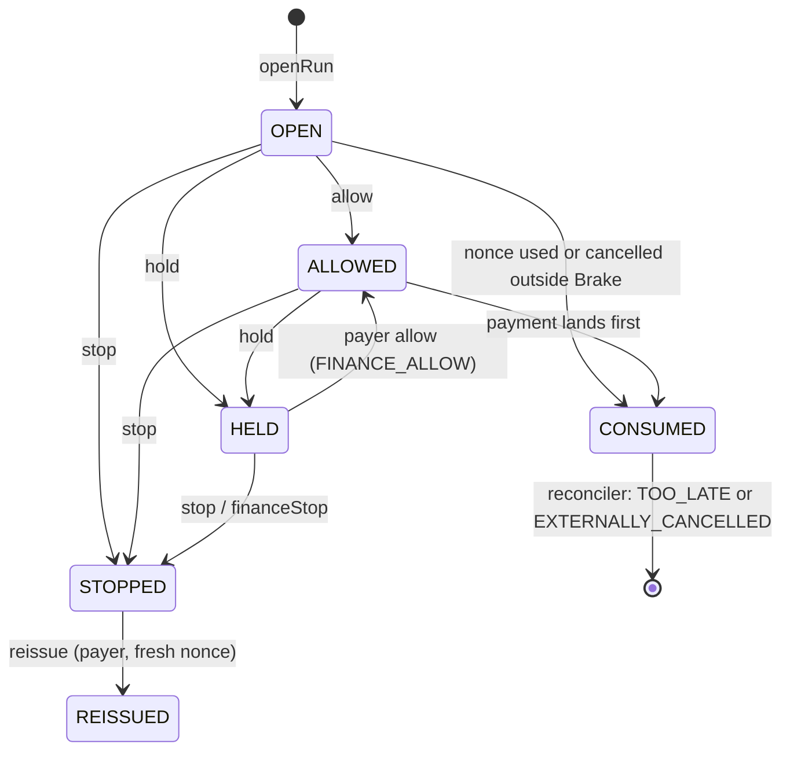
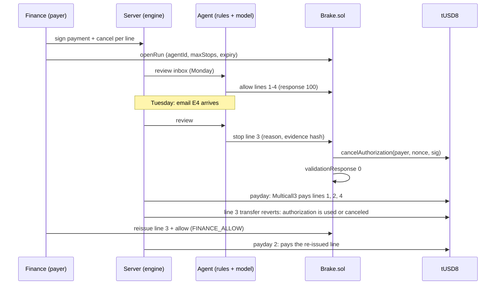

# Brake — architecture

Regenerated from the code at HEAD: `src/Brake.sol`, `packages/engine/src/*`, `packages/brake-signer/src/*`, `apps/web/app/*`.

## Components

```mermaid
flowchart TB
  subgraph Web[apps/web · Next.js 16]
    UI[Run sheet · Agent desk · Payday · Verify · Play-the-hero]
    API[app/api/[...path] → createApi]
  end
  subgraph Signer[packages/brake-signer]
    SG[openRun · stopLine · lineStatus · verifyEvidence]
  end
  subgraph Engine[packages/engine/src]
    RUNS[runs.ts · api.ts]
    AGENT[agent/: domain · pipeline · review · model]
    EXEC[executor.ts: holds cancel signatures]
    KEEP[keeper.ts: holds payment signatures]
    REC[reconciler.ts: log scan → status]
    JOBS[jobs.ts: queued retries]
  end
  DB[(Postgres schema.sql)]
  LLM[Anthropic API · claude-sonnet-5-5]
  subgraph Aevum[Aevum testnet 44005 · live]
    BR[Brake.sol]
    IR[ERC-8004 Identity]
    VR[ERC-8004 Validation]
    T[tUSD8 FiatToken]
    MC[Multicall3]
  end
  UI --> API --> RUNS
  RUNS --> SG
  RUNS --> DB
  RUNS --> AGENT -->|messages as untrusted data| LLM
  AGENT -->|STOP / HOLD / ALLOW| EXEC
  EXEC -->|stop + cancel signature| BR
  BR -->|cancelAuthorization| T
  BR -->|validationRequest / Response| VR
  BR -.agentId.-> IR
  KEEP -->|aggregate3: transferWithAuthorization| MC --> T
  REC -->|logs| BR
  REC --> DB
  JOBS --> EXEC
```

## Trust boundaries

- The model sees messages as quoted data and has one tool, `record_findings`. It holds no signature and no key. `packages/engine/test/invariants.test.ts` asserts the agent module has no path to signatures, keys or the database.
- Deterministic rules can only STOP. No model finding can turn a rule STOP into ALLOW or HOLD (invariant I4, `agent.test.ts:229`).
- The agent wallet holds 0 tUSD8 and no allowance. Its on-chain powers are `allow`, `hold` and `stop` on a run that names it, within `agentExpiry` and `maxStops`.
- The executor holds cancel signatures and the keeper holds payment signatures (encrypted at rest); both are in the server. In wallet mode the server receives signatures only.

## Line state machine (`Brake.Status`)



## Hero sequence



## Contract surface (`src/Brake.sol`)

`openRun`, `allow`, `hold`, `stop`, `financeStop`, `reissue`, `revokeAgent`, `retryReceipt`; views `lineOf`, `lineDetail`, `runOf`, `requestHashOf`, `isStopReason`, `isHoldReason`. Events: `RunOpened`, `LineAllowed`, `LineStopped`, `LineHeld`, `StopConsumed`, `StopAlarm`, `AgentRevoked`, `LineReissued`, `ReceiptRecorded`, `ReceiptFailed`. `MAX_LINES` is 64. Validation responses: ALLOW 100, HOLD 50, STOP 0.

A registry failure never blocks a safety action: the receipt is retried (`retryReceipt`, `ReceiptFailed`).

## Reconciliation and finality

The reconciler scans Brake and tUSD8 logs and derives status (including `AuthorizationUsed` → TOO_LATE). Statuses are provisional for `CONFIRMATIONS` blocks (default 3), with rollback of reorged projections inside that window; the `finalized` tag is reported separately and lagged `latest` by 4,643 blocks when observed (`evidence/finality-observation.json`).

## Deployment

Next.js on Vercel at [app.brake.edycu.dev](https://app.brake.edycu.dev/) with `apps/web/vercel.json` (daily Cron tick), `.github/workflows/tick.yml` as a backstop tick every 5 minutes, and Neon Postgres. Reviews are event-driven (run on delivery through `after()`); the tick is a backstop only. Contracts are live on Aevum testnet 44005; addresses and the live run hashes are in the README.
