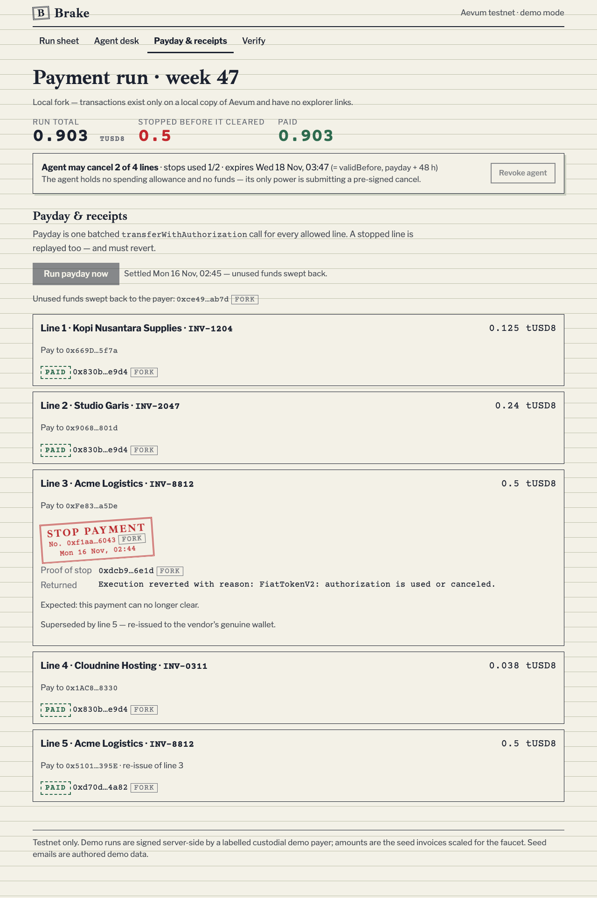
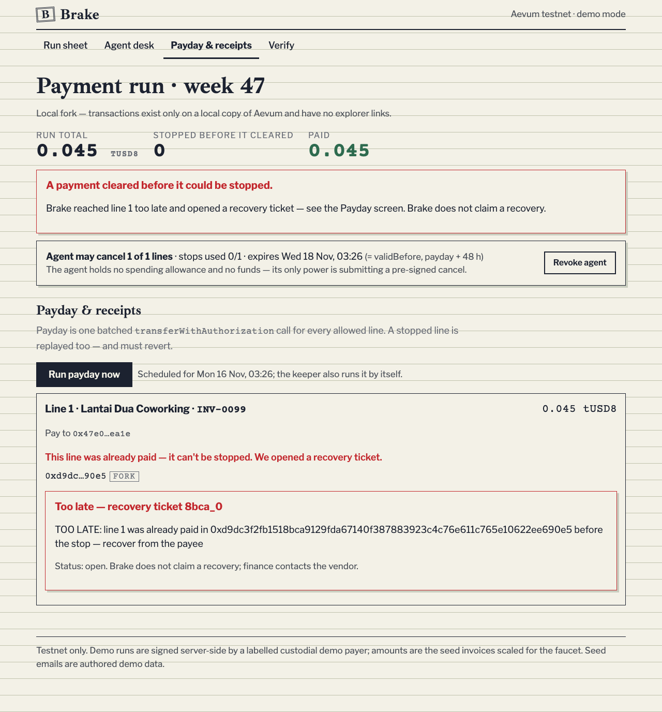
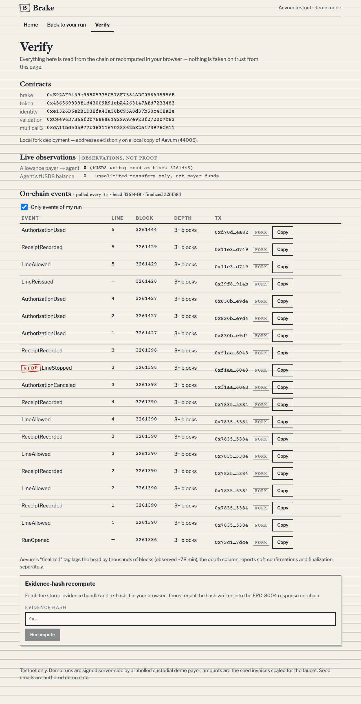
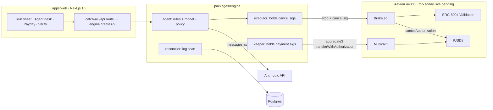

<div align="center">
  
  <h1>Brake 🛑</h1>
  <p><em>Pre-signed stop-payments for stablecoin payment runs.</em></p>
  
  <p>Finance signs each payment together with its cancellation. A monitor agent can stop a line or hold it for finance, and it cannot create a payment or change where one goes.</p>

  <p><strong>Status: built and tested on an anvil fork of Aevum 44005. The live testnet deployment, live URL and explorer-verified contracts are pending testnet funding</strong> (see <a href="#%EF%B8%8F-live-deployment">Live Deployment</a>).</p>

  <br/>

  [](https://app.brake.edycu.dev/)
  [](JUDGE.md)
  [](https://brake.edycu.dev/)
  [](https://brake.edycu.dev/pitch/)
  [](https://dorahacks.io/hackathon/qday/detail)

  <br/>

  
  
  
  
  
  
  [](https://opensource.org/licenses/MIT)
  [](https://github.com/edycutjong/brake/actions/workflows/ci.yml)
  [](https://github.com/edycutjong/brake/releases/latest)

</div>

---

## 📸 See it in Action

Screens of the product running against a local anvil fork of Aevum 44005 (labelled: not the live chain). The hero walk through the real UI takes about a minute (engine hero run: 64.4 s, `evidence/hero-fork.json`; script: `apps/web/e2e/hero_walk.py`).

| Run sheet (Monday: every line ALLOWED) | Run sheet (Tuesday: line 3 STOPPED) |
|---|---|
|  |  |

| Agent desk (decision cards, model-only wording) | Payday and receipts (proof-of-stop revert) |
|---|---|
|  |  |

| TOO LATE (payment landed first, recovery ticket) | Verify (recompute evidence in the browser) |
|---|---|
|  |  |

## 💡 The Problem & Solution

### The Problem

Finance teams approve vendor payments days before payday, and things change in between: an invoice is disputed, goods do not arrive, or a "we changed our bank details" email turns out to be fraud. Business email compromise drew $2,770,151,146 in reported losses across 21,442 complaints to the FBI's IC3 in 2024 ([FBI IC3 2024 Internet Crime Report](https://www.ic3.gov/AnnualReport/Reports/2024_IC3Report.pdf), complaint and loss tables). On a stablecoin chain the payer cannot recall a payment once it lands. Today, stopping a scheduled crypto payment needs the key holder online, and giving a bot a key that can pay means a hijacked bot can pay.

### The Solution

For every line of a payment run, finance signs two EIP-712 messages once: the payment (`transferWithAuthorization`, valid only from payday) and its matching `cancelAuthorization`. A monitor agent reads the untrusted inputs (vendor email, the vendor master's change history, the invoice and dispute ledger, tUSD8's own `isBlacklisted`) and records a decision per line on-chain. Its only powers are `allow`, `hold` and `stop`:

- **Stop:** the `Brake` contract submits the pre-signed cancel to tUSD8 with a reason code and an evidence hash, and records the decision in an ERC-8004 Validation Registry. The paid-line attempt on payday then reverts with the token's own error (`FiatTokenV2: authorization is used or canceled.`).
- **Hold:** Brake's keeper will not pay the line until finance decides, and the hold is recorded on-chain; one payer `allow` releases it without re-signing. A hold is not a token-level block: the signed payment stays valid at tUSD8 until `validBefore`, so a confirmed risk is a `stop`.
- **Re-issue:** finance replaces a falsely stopped line in one click (demo mode; in a non-custodial run the server holds no payer key and refuses, so the payer would call `Brake.reissue` from their own wallet, which `scripts/sign_local.ts` does not do yet).

The agent holds 0 tUSD8 and no allowance (checked on `/verify`). A hijacked agent can delay a payment; it cannot create one or change where one goes. Brake does not claim to stop BEC in general. It stops a signed line when a signal arrives before payday (see [Honest Limitations](#attacks-defeated-and-honest-limitations)).

Nearest neighbours and why Brake differs: [docs/COMPARISON.md](docs/COMPARISON.md).

## 🏗️ Architecture & Tech Stack

<p align="center">
  <a href="https://brake.edycu.dev/architecture.html"></a>
</p>

<sub>Full-size page: <a href="https://brake.edycu.dev/architecture.html">brake.edycu.dev/architecture.html</a> (source: <a href="docs/architecture.html">docs/architecture.html</a>).</sub>

<details>
<summary><b>Component graph (Mermaid)</b>: click to expand</summary>



</details>

Full component and sequence diagrams: [ARCHITECTURE.md](ARCHITECTURE.md).

| Layer | Choice |
|---|---|
| Chain | Aevum testnet, chain id 44005, RPC `https://rpc-test.qday.info`, explorer `https://explorer-test.qday.info` |
| Token | tUSD8 `0x456569838f1d43009A91ebA4263147Afd7233483`, a FiatToken (EIP-3009, EIP-2612) |
| Contracts | Solidity 0.8, Foundry, OpenZeppelin; `src/Brake.sol`, `src/ERC8004Bootstrap.sol` |
| Signing | `packages/brake-signer` (viem), pairs payment + cancel |
| Engine | `packages/engine` (TypeScript): agent, executor, keeper, reconciler, API handlers |
| App | Next.js 16 on Vercel (config prepared), Postgres (planned: Neon via Vercel Marketplace; not provisioned yet) |
| Model | `claude-sonnet-5-5`, one forced tool (`record_findings`), no temperature parameter set, no pay tool, no signatures |
| Batching | Multicall3 `aggregate3` for the payday batch |

## 🏆 QDay Aevum Integration

Brake builds on what is live on Aevum 44005 (checked with `eth_getCode` / `eth_call` against `https://rpc-test.qday.info`), and does not use what is not live (`@qday-io/sdk`, PQ precompiles, a public bundler or paymaster).

- **tUSD8 EIP-3009** `transferWithAuthorization`, `cancelAuthorization`, `authorizationState`, plus `isBlacklisted`: the whole stop mechanism. G1 proves any caller, an EOA or a contract, can submit a payer's pre-signed cancel (`test/G1CancelAuthority.t.sol`, 7 tests; `evidence/g1-fork.json`).
- **Multicall3** `aggregate3`: one payday transaction pays N lines.
- **ERC-8004**: the canonical ERC-8004 Identity and Reputation addresses have no code on 44005 (`evidence/live-chain-probe.json`), so Brake self-deploys the reference registries (`src/ERC8004Bootstrap.sol`, reference commit `b9e466c`, answers in `evidence/g2a.json`). `openRun` binds the agent's identity (`agentId`); each decision writes a Validation Registry response (ALLOW 100, HOLD 50, STOP 0).
- **Arachnid CREATE2** deployer for deterministic addresses.

### Rubric map

| Criterion | Where in Brake |
|---|---|
| Scoped session keys, least privilege | A contract-level grant, not a Kernel session key: per run, three functions (`allow`, `hold`, `stop`), expiry (`agentExpiry`, a payer-chosen timestamp; the engine sets it to payday + 48 h), a stop budget, `revokeAgent`, `agentId`-bound. No spend exists to scope: the agent's cap is zero |
| Spending limits | Agent spend is zero by construction; its stops are capped by `maxStops` |
| Instant revocation | `revokeAgent` (Brake-routed stops; scope in limitations) |
| Identity primitives | ERC-8004 Identity `agentId` bound in `openRun`; Validation response per decision |
| Transaction review and approval | Run sheet review before signing; HELD lines and escalations wait for finance (keeper-side hold) |
| Verifiable on-chain audit trail | `LineStopped` / `LineAllowed` / `LineHeld` with reason and evidence hash; recompute box on `/verify` |
| Retries, async confirmations, edge cases | Idempotent stop, per-EOA nonce queue, receipt retry, CONSUMED → TOO LATE / EXTERNALLY CANCELLED |
| Prompt injection | The model has no pay tool and no signatures; rules can only STOP; verbatim-quote check; 25-email injection suite |

## ⛓️ Live Deployment

**Not yet deployed to the live chain.** The testnet wallets were unfunded when this was built (faucet step pending), so every transaction below ran on an anvil fork of Aevum 44005. Fork hashes exist only on that fork, are never on the explorer, and are labelled `fork` everywhere. The live re-run (deploy, explorer verification, hero, TOO LATE, flood, `sign_local`) is a scripted first step once the wallets are funded.

| Item | Value | Status |
|---|---|---|
| tUSD8 (live, read-only target) | `0x456569838f1d43009A91ebA4263147Afd7233483` | live on 44005 ([explorer](https://explorer-test.qday.info/address/0x456569838f1d43009A91ebA4263147Afd7233483)) |
| Multicall3 | `0xcA11bde05977b3631167028862bE2a173976CA11` | live on 44005 |
| Brake (fork) | see `evidence/deploy-44005-fork.json` | fork only |
| Brake, registries (live) | pending | not deployed, not verified |

Fork evidence (each file is labelled `deployment: fork`; `g1-fork.json` records its fork block 3252145, and the forge tests pin `FORK_BLOCK` 3252000): `evidence/hero-fork.json`, `late-fork.json`, `flood-fork.json`, `g1-fork.json`, `sign-local-fork.json`. The reproduce steps are in [DEMO.md](DEMO.md).

## 📊 Engineering Rigor

| Metric | Value | Source |
|---|---|---|
| Tests | 126 passing: forge 50 + brake-signer 12 + engine 64 | `evidence/test-counts.json` |
| Property checks (fast-check) | 3 properties × 10,000 generated cases = 30,000, 0 counterexamples | `packages/engine/test/properties.test.ts` |
| E2E (Playwright) | 24 passing: `/judge` with no credentials, no-key smoke, responsive 375/768/1440, desktop + Pixel 7 | `apps/web/e2e/*.spec.ts` |
| Forge tests run against | tUSD8 state at fork block 3252000 | `evidence/test-counts.json` |
| Latency, email to cancel confirmed (fork, n=11) | p50 4,116 ms, p95 6,285 ms | `bench/results.json` |
| Gas, median | stop 183,023 · allow 1,092,452 · payday 109,418 · reissue 312,767 (measured at `494c2a6`, before the a2a architecture contract change) | `bench/results.json` |
| Agent-initiated transfers | 0 | `bench/results.json` |
| Hero, model-only stop (5 runs, at `dbb1acb`) | line 3 STOP 5/5 with 0 rules fired; Monday ALLOW all lines 5/5; with the model stubbed, line 3 is ALLOWED | `evidence/g4/hero-sonnet-5-5-cli.json` |

The model runs used `claude-sonnet-5-5` through a local CLI adapter (labelled in each file). The SDK path was not measured. **The injection-suite and hero model numbers were measured at commit `dbb1acb` (rules-only tune baseline at `2ba7609`), before the agent changes of the a2a architecture review (unverified findings now HOLD, fail-closed model output, quote verifier); re-measuring them is on the roadmap.**

### Injection suite (25 emails, G4)

| Split | Model | n | Correct | Missed stops | False stops | False holds | Collateral stops |
|---|---|---|---|---|---|---|---|
| Tune | rules only | 19 | 4 | 8 | 0 | 0 | 0 |
| Tune | claude-sonnet-5-5 | 19 | 19 | 0 | 0 | 0 | 3 |
| Held-out | rules only | 6 | 2 | 2 | 0 | 0 | 0 |
| Held-out | claude-sonnet-5-5 | 6 | 6 | 0 | 0 | 0 | 1 |

n is small (25), so read these as a regression suite, not a detection rate. The rules-only rows' other misses are HOLD-labelled injection emails that rules alone leave unflagged: 7 in the tune split, 2 held out (`evidence/g4/*-none.json`). "Collateral" lines are emails that name the fraud wallet, which is also the on-file payee of another line, so that line stops too; each is reported per row. The 6 held-out emails were committed before tuning (`680805f`). Source: `bench/results.json`, `evidence/g4/`.

### Attacks defeated

| Control | Why it is load-bearing | Test |
|---|---|---|
| The agent cannot pay | `agentHoldsNoSpendingPower_brakeNeverHoldsFunds` | `test/Brake.t.sol:256` |
| Only the grant holder acts; revoked and expired agents are refused | stranger, revoked, expired | `test/Brake.t.sol:233` |
| No model output can turn a rule STOP into ALLOW or HOLD | invariant I4 | `packages/engine/test/agent.test.ts:203` |
| … for any generated model output (10,000 cases) | property: rules are consulted first | `packages/engine/test/properties.test.ts` |
| A fabricated quote never verifies (10,000 cases) | property: quotes must be verbatim | `packages/engine/test/properties.test.ts` |
| Unverified findings never ALLOW (10,000 cases) | property: fail-closed | `packages/engine/test/properties.test.ts` |
| Injection alone HOLDs, never ALLOWs | | `packages/engine/test/agent.test.ts:218` |
| A paraphrased or misattributed model quote is dropped | verbatim quote check | `packages/engine/test/agent.test.ts:168` |
| Email text cannot forge the prompt's data tags | | `packages/engine/test/agent.test.ts:123` |
| Model failure never becomes ALLOW | rules still STOP; the rest stay undecided | `packages/engine/test/agent.test.ts:107` |
| Stop is idempotent and charges the budget once | | `test/Brake.t.sol:157` |
| Payment lands first: TOO LATE, no budget charged | | `test/BrakeLifecycle.t.sol:228` |
| A hostile registry cannot re-enter during the receipt | | `test/BrakeLifecycle.t.sol:258` |
| A failing registry never blocks a stop | receipt retried later | `test/BrakeReceipts.t.sol:15` |

### Honest limits (12)

1. **Brake prevents only what it detects.** A wrong stop costs a late payment (re-issue). A fraud that neither the rules nor the model flag, such as a BEC email from the vendor's real, compromised mailbox with no payee change on file, pays as it would without Brake. A prompt injection can suppress a stop that only the model would have made; it cannot create a payment or change a payee.
2. **Brake trusts the vendor file's recorded verifications.** It cannot prove a past "phone-verified" change used an independent number.
3. **Brake acts only on what arrives before payday.** Had the attacker stayed silent, line 3 in the hero would have paid.
4. **If a payment was already redeemed,** Brake reports TOO LATE and opens a recovery ticket. It cannot claw funds back.
5. **The stop budget binds only the Brake path.** Anyone holding a raw cancel signature can submit it to tUSD8 directly, so a compromised server can cancel every line (a delayed run). The same server holds the encrypted payment signatures, so a compromise can also pay an undecided line to its signed payee without review; it cannot change payee or amount. A hijacked agent can cancel up to `maxStops` lines per run (set per run by the payer; the demo scenarios use 2, 1 and 2) and can HOLD any line, so it can delay a run. Each stop is re-issuable and each hold is released by one payer `allow`.
6. **A HELD line with finance away** stays unpaid until `validBefore` (payday + 48 h), then shows EXPIRED and needs a re-signed line.
7. **Revocation scope.** `revokeAgent` blocks Brake-routed stops at once; signatures already issued stay valid (cancels until the line is consumed, payments until `validBefore`).
8. **Demo mode is custodial:** the server holds a testnet demo payer key. The authorization-only mode is `scripts/sign_local.ts` (your key signs, the server holds only signed authorizations; ran on the fork in `evidence/sign-local-fork.json`).
9. **Finality.** Statuses are provisional for `CONFIRMATIONS` blocks (3). The `finalized` tag lagged `latest` by 4,643 blocks (about 78 min) when observed (`evidence/finality-observation.json`); reorg depth on Aevum was not measured.
10. **Privacy:** vendor email text goes to the Anthropic API for the model step; only hashes go on-chain.
11. Tested on Aevum's tUSD8 only; the mechanism should port to other FiatToken-v2 chains. The issuer can pause or blacklist tUSD8, which blocks both payments and cancels.
12. Not built: IMAP inbox, Docker image, npm publish of `brake-signer` (human step).

## 🚀 Getting Started

### Prerequisites

Node 22 or newer, pnpm 10, Foundry, Postgres, and `anvil` for a local fork. No secret lives in the repo: local runs read `~/.config/brake/` (wallet keys, app env, model key).

### Installation

```bash
pnpm install
pnpm fork:up          # anvil fork of Aevum 44005 + deploy
pnpm demo:hero        # the hero run end to end (needs a model: BRAKE_MODEL=claude-cli or an Anthropic key)
```

Environment variables (names only; values never committed):

| Variable | Purpose |
|---|---|
| `DEPLOYMENT` | `fork` or `live` |
| `BRAKE_MODEL` | `anthropic`, `claude-cli` (dev adapter) or `none` (ablation) |
| `ANTHROPIC_API_KEY` | model step (live) |
| `DATABASE_URL`, `DATABASE_URL_TEST` | Postgres |
| `DEMO_PAYER_PRIVATE_KEY`, `AGENT_PRIVATE_KEY`, `KEEPER_PRIVATE_KEY` | demo payer, monitor agent, keeper wallets (agent holds no funds) |
| `AGENT_ADDRESS` | the agent's address, bound to its ERC-8004 identity |
| `SIG_ENC_KEY` | encrypts stored signatures at rest |
| `PAYEES_MNEMONIC` | seed vendor payee wallets |
| `CRON_SECRET` | authenticates the backstop tick |
| `PUBLIC_URL` | public base URL |
| `DAILY_SPEND_CAP_UNITS` | demo payer's daily cap |
| `DEPLOY_BLOCK`, `TX_STUCK_AFTER_S` | reconciler start block, stuck-tx replacement delay |

`scripts/vercel_env.sh` pushes them to Vercel through stdin without echoing.

### API reference

Mounted at `/api/*` through one catch-all route (`apps/web/app/api/[...path]/route.ts`, handlers in `packages/engine/src/api.ts`):

| Route | Purpose |
|---|---|
| `GET /api/plan`, `POST /api/runs` | wallet mode: get the lines to sign, then create the run from signatures (server recovers each signer) |
| `POST /api/runs/:id/open`, `/opened` | open the run on-chain, confirm the `openRun` receipt |
| `GET /api/runs/:id` | run state and lines |
| `POST /api/runs/:id/inbox`, `GET` same | add or list vendor messages |
| `POST /api/runs/:id/review` | manually enqueue a review (budgeted; reviews also run on every inbox delivery) |
| `POST /api/runs/:id/lines/:idx/decide`, `/reissue` | finance decision on a HELD line; re-issue a stopped line |
| `POST /api/runs/:id/revoke` | revoke the agent for the run |
| `POST /api/runs/:id/payday` | keeper: pay ALLOWED lines (Multicall3), proof-of-stop txs, HELD tickets; idempotent |
| `GET /api/evidence/:hash` | evidence bundle for a decision hash |
| `GET`/`POST /api/keeper/tick` | backstop tick (authenticated by `CRON_SECRET`) |
| `GET /api/verify/events`, `/api/verify/observations`, `/api/health` | on-chain event feed, tUSD8 observations, health |

Contract surface (`src/Brake.sol`): `openRun`, `allow`, `hold`, `stop`, `financeStop`, `reissue`, `revokeAgent`, `retryReceipt`, and the views `lineOf`, `lineDetail`, `runOf`, `requestHashOf`, `isStopReason`, `isHoldReason`.

## 🧪 Testing & CI

```bash
forge test                                   # 50 fork tests (tUSD8 state at block 3252000)
pnpm --filter brake-signer test              # 12
pnpm --filter @brake/engine test             # 64 incl. 3 fast-check properties (integration tests skip without a fork and local keys)
pnpm g4                                      # the 25-email injection suite
python3 scripts/bench.py                     # reproduce bench/results.json from evidence/bench-rows.json
python3 apps/web/e2e/hero_walk.py            # the hero through the real UI (needs pnpm fork:up)
pnpm e2e                                     # Playwright: /judge no-auth, smoke, responsive
pnpm lighthouse                              # Lighthouse CI: app + landing/deck
pnpm ci                                      # fmt + forge + typecheck + tests + build
```

**6-stage pipeline** (`.github/workflows/ci.yml`): Quality → Security → Build → E2E → Performance → Deploy gate.

| Stage | Gate |
|---|---|
| 1 · Quality | `forge fmt --check`, `forge build --sizes`, 50 fork tests · typecheck + unit/property tests on node 22 and 24 |
| 2 · Security | gitleaks over full history · `pnpm audit --prod` · licence check (no GPL-3.0/AGPL-3.0) |
| 3 · Build | Next.js production build · bundle budget (warn 1,500 KB, fail 2,000 KB) · `brake-signer` pack |
| 4 · E2E | Playwright on desktop Chrome + Pixel 7 |
| 5 · Performance | Lighthouse CI on the app and the landing/deck; accessibility ≥ 0.9 is a hard gate |
| 6 · Deploy gate | main only, after every stage above |

Also: CodeQL (`codeql.yml`), Dependabot (grouped, monthly), and `release.yml`, which tags a semantic version from Angular-convention commits (`feat:` minor, `fix:` patch). The 19 engine integration tests need a local anvil fork and keys, so CI runs them as skipped; they pass locally with `pnpm fork:up` (`evidence/test-counts.json`).

## 📁 Project Structure

```
src/                  Brake.sol, ERC8004Bootstrap.sol, interfaces
test/                 forge fork tests (G1 cancel authority, lifecycle, receipts, ERC-8004)
packages/brake-signer EIP-3009 pair signing, openRun / stopLine / lineStatus / verifyEvidence
packages/engine       agent, executor, keeper, reconciler, API handlers, schema.sql
apps/web              Next.js app: run sheet, agent desk, payday, verify, Play-the-hero
scripts/              kill_test, demo_hero / demo_edge, g4, bench, sign_local, fork_up
seed/                 vendors, invoices, runs, inbox, 25 injection emails + labels
evidence/             raw results; *-fork.json come from a fork, not the live chain
docs/                 DX-REPORT.md, COMPARISON.md, screenshots
```

## 🗺️ Roadmap

- [x] G1: any caller can submit a payer's pre-signed cancel on tUSD8 (fork)
- [x] Brake contract, ERC-8004 receipts, re-issue, stop budget, TOO LATE
- [x] Agent: rules, model, policy, verbatim-quote check; injection suite
- [x] Product app and guided hero walk
- [x] `sign_local.ts` authorization-only run (fork)
- [ ] Live deploy on 44005, explorer verification, live hero / TOO LATE / flood runs (needs funded wallets)
- [ ] Re-measure the model step through the Anthropic SDK path
- [ ] Re-generate bench and fork evidence from the live run
- [ ] `brake-signer` npm publish (human step)

## 📽️ Demo Materials

Reproduce steps and fork hashes: [DEMO.md](DEMO.md). Friction log for QDay: [docs/DX-REPORT.md](docs/DX-REPORT.md). Landing page: https://brake.edycu.dev/ ([source](docs/index.html)). Pitch deck: https://brake.edycu.dev/pitch/ ([source](docs/pitch/index.html)). One page for judges: [JUDGE.md](JUDGE.md) (also `/judge` in the app). Live app: https://app.brake.edycu.dev/ (Aevum testnet 44005).

## 📄 License

MIT, see [LICENSE](LICENSE).

## 🙏 Acknowledgments

Circle's FiatToken (EIP-3009) design, the ERC-8004 reference registries (`erc-8004/erc-8004-contracts`, commit `b9e466c`), and the QDay team's Aevum testnet.
